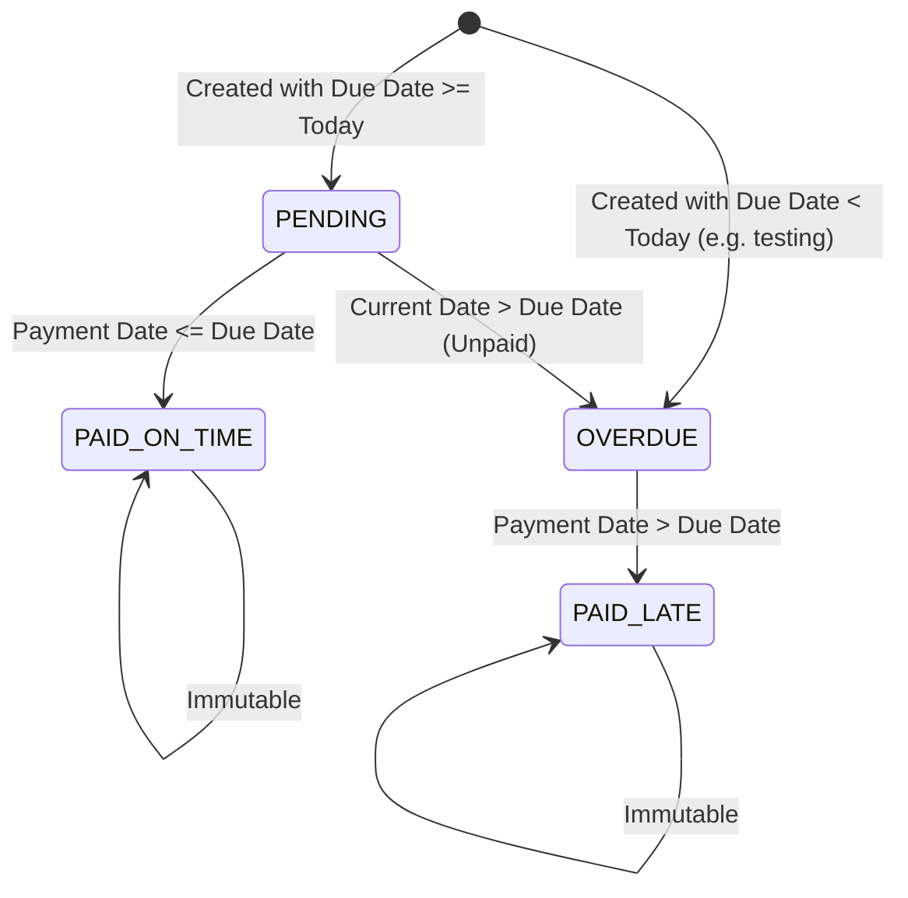

# Feature Documentation: Bill Due Date & Payment Timing Detection (Paid On Time vs. Paid Late)

**Repository:** `housing-society-billing-portal`  
**Branch:** `feature/week15-final-validation`  
**Feature:** Dynamic Due Date Tracking, Overdue Detection, and On-Time vs. Late Payment Distinction  

---

## 1. Requirement & Rationale

### 1.1 Background
In housing society management, monthly maintenance and utility charges must be settled by residents within an agreed grace period. Initially, bills only supported binary statuses (`UNPAID` and `PAID`), followed by dynamic due date and `OVERDUE` detection. The current system distinguishes payments made on time from payments made after the due date.

### 1.2 Objective
Maintain the established due date and overdue tracking while categorizing settled bills into:
1. **`PAID ON TIME`** when payment is completed on or before the due date.
2. **`PAID LATE`** when payment is completed after the due date.

Both `dueDate` and `paymentDate` are preserved and persisted, enabling accurate verification of payment timeliness.

---

## 2. Business Logic & Bill Lifecycle

A bill transitions through four well-defined states:



### 2.1 Four State Definitions
| State | Condition | Visual Indicator |
| :--- | :--- | :--- |
| **`PENDING`** | Payment has not been made, and current date $\le$ `dueDate`. | Amber badge (`#fef3c7`), prompt to settle before deadline. |
| **`OVERDUE`** | Payment has not been made, and current date $>$ `dueDate`. | Crimson alert badge (`#fee2e2`), pulsing animation, urgent settlement prompt. |
| **`PAID ON TIME`** | Payment has been made, and `paymentDate` $\le$ `dueDate`. | Emerald green badge (`#dcfce7`), official confirmation receipt. |
| **`PAID LATE`** | Payment has been made, and `paymentDate` $>$ `dueDate`. | Orange/amber badge (`#ffedd5`), late payment notice on receipt. |

### 2.2 Concrete Examples
| Due Date | Payment Date | Current Date | Calculated Status |
| :---: | :---: | :---: | :---: |
| `2026-10-10` | `2026-10-10` | `2026-10-19` | **`PAID ON TIME`** |
| `2026-10-10` | `2026-10-19` | `2026-10-19` | **`PAID LATE`** |
| `2026-10-10` | *(None)* | `2026-10-19` | **`OVERDUE`** |
| `2026-10-25` | *(None)* | `2026-10-19` | **`PENDING`** |

### 2.3 Core Business Rules Enforced
1. **No Lingering Overdue Status:** An overdue bill must **NOT** remain `OVERDUE` once payment is recorded. It immediately becomes `PAID LATE` (or `PAID ON TIME` if paid on or prior to due date).
2. **Date Preservation:** Neither `dueDate` nor `paymentDate` is overwritten or removed upon payment. Both dates remain accessible to verify payment timeliness at any time.
3. **No Financial Penalties:** Fines or late-payment penalty fees are not added, adhering strictly to pure deadline detection.
4. **Receipt Generation:** Receipts accurately reflect the payment status (`PENDING`, `OVERDUE`, `PAID ON TIME`, or `PAID LATE`) and include all dates, charge breakdowns, and status notices.

---

## 3. Technical Implementation

### 3.1 Backend Architecture
- **Entity (`Bill.java`):**
  - Maintains `dueDate` (`java.time.LocalDate`) and `paymentDate` (`String`).
  - Added `@JsonIgnore public LocalDate getParsedPaymentDate()` to support parsing both standard `yyyy-MM-dd` and localized `dd-MM-yyyy` date formats safely.
  - Dynamic `getStatus()` logic:
    ```java
    public String getStatus() {
        LocalDate pDate = getParsedPaymentDate();
        boolean hasPaidFlag = (this.status != null && this.status.toUpperCase().startsWith("PAID"));

        if (pDate != null || hasPaidFlag) {
            if (pDate != null && dueDate != null) {
                if (pDate.isAfter(dueDate)) {
                    return "PAID LATE";
                }
                return "PAID ON TIME";
            }
            if ("PAID LATE".equalsIgnoreCase(this.status)) {
                return "PAID LATE";
            }
            return "PAID ON TIME";
        }

        if (dueDate != null && LocalDate.now().isAfter(dueDate)) {
            return "OVERDUE";
        }
        return "PENDING";
    }
    ```
- **REST Controller (`BillController.java`):**
  - `POST /bills`: Evaluates payment timing if `paymentDate` is supplied, else sets `OVERDUE` (if past) or `PENDING` (if future).
  - `PUT /bills/{id}`: Preserves payment dates and computes `PAID ON TIME` vs `PAID LATE`.
  - `PUT /bills/{id}/pay`: Records today's payment date. If today $>$ `dueDate`, marks `PAID LATE`; otherwise `PAID ON TIME`.
  - `GET /bills/{id}/receipt`: Returns `BillReceipt` containing `dueDate`, formatted `paymentDate`, and accurate `PAID ON TIME` / `PAID LATE` status.

### 3.2 Frontend Architecture (`static/index.html`)
- **Table Badges:** Styled `.status-badge.paid-on-time` (emerald) and `.status-badge.paid-late` (orange-amber).
- **Mark as Paid Action:** Updates status immediately upon receiving the response from the server.
- **Receipt Modal:** Displays receipt badge matching the four states, with distinct notice messages for timely vs. late payments.
- **Download Receipt:** Generates formatted `.txt` receipt preserving `PAID ON TIME` and `PAID LATE` statements.

---

## 4. Automated Testing & Verification

The portal is validated by **22 automated tests** (17 unit/integration + 5 Selenium E2E).

| Test Class | Category | Count | Status | Description |
| :--- | :--- | :---: | :---: | :--- |
| `BillingPortalApplicationTests` | Smoke / Context | 1 | Passed | Spring Boot context loads successfully. |
| `Week6ValidationAndReceiptTests` | Unit & Integration | 16 | Passed | Validates validation constraints, due date persistence, and all four status states: PENDING, OVERDUE, PAID ON TIME ($paymentDate \le dueDate$), and PAID LATE ($paymentDate > dueDate$), plus receipt verification. |
| `SeleniumE2ETests` | End-to-End UI | 5 | Passed | Headless Chrome tests covering: dashboard load, resident creation, bill creation with due date, on-time payment status update (`PAID ON TIME`), and receipt modal presentation. |
| **Total Automated Tests** | **All Suites** | **22** | **Passed** | **100% Pass Rate (0 failures, 0 errors)** |

---

## 5. Verification Commands

```powershell
# 1. Run Unit & Integration Tests (17 tests)
mvn test -Dtest=!SeleniumE2ETests -f application/pom.xml

# 2. Package Executable JAR
mvn package -DskipTests=true -f application/pom.xml

# 3. Run Selenium End-to-End Tests against live portal (5 tests)
mvn test "-Dtest=SeleniumE2ETests" "-Dapp.url=http://localhost:8081/index.html" -f application/pom.xml
```
